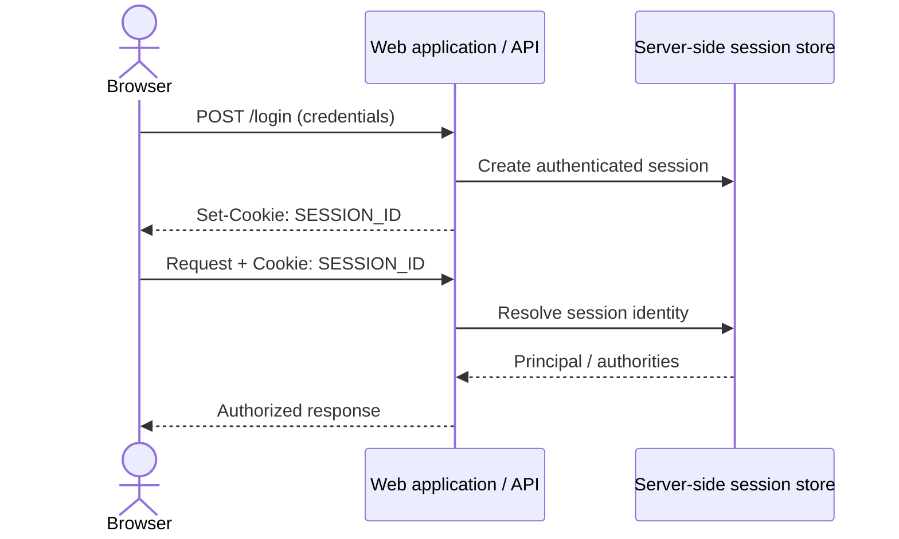

# SBA301 Slot 24 — REST Security / Authentication / Authorization / JWT

Demo Spring Boot 3 / Spring Security 6 cho luồng signup, login, phát hành JWT, kiểm tra bearer token và phân quyền. JWT chỉ là định dạng token; OAuth 2.0 là authorization framework. Project này minh họa cơ chế JWT tự ký để học tập, **không phải Authorization Server hoặc cấu hình production**.

## Core mental model

- **Confidentiality** giới hạn ai đọc được dữ liệu; **integrity** phát hiện dữ liệu bị sửa; **authentication** xác minh danh tính; **authorization** quyết định danh tính đó được làm gì.
- Session/cookie lưu trạng thái ở server và browser tự gửi cookie; cần hiểu CSRF. HTTP Basic gửi credential trên mỗi request (chỉ dùng qua TLS); Digest là cơ chế challenge-response cũ, không phải lựa chọn API hiện đại. Certificate-based security xác thực bằng chứng thư/khóa client. Bearer token thuận tiện cho REST nhưng ai nắm token có thể dùng token.
- OAuth 2.0 định nghĩa 4 vai trò: Resource Owner cấp quyền; Client yêu cầu quyền; Authorization Server cấp token; Resource Server bảo vệ API. OpenID Connect bổ sung lớp identity trên OAuth 2.0. JWT là một token format, không đồng nghĩa với OAuth 2.0.
- JWT gồm Header, Payload (claims) và Signature. Payload thường chỉ Base64URL-encoded, không bí mật; signature validation xác minh integrity/nguồn phát hành, còn `exp` giới hạn thời gian sử dụng.
- Request đi qua `SecurityFilterChain` → xác thực credentials/token → `SecurityContext` → authorization → controller. 401 = chưa xác thực/credential không hợp lệ; 403 = đã xác thực nhưng thiếu quyền.
- `UserDetailsService` nạp principal; `PasswordEncoder` hash và so khớp password; `AuthenticationProvider` thực hiện xác thực; `AuthenticationManager` điều phối provider.

## Cấu hình và chạy

Yêu cầu JDK 21, Maven 3.9+ và SQL Server. Trước khi chạy ứng dụng, thực thi script SQL Server dưới đây trong SSMS/sqlcmd bằng tài khoản có quyền tạo database. Script tạo database `OrchidManagementDB`, bảng `dbo.app_user` tương thích với entity/JPA và hai tài khoản test; chạy lại không tạo trùng dữ liệu.

```sql
IF DB_ID(N'OrchidManagementDB') IS NULL
    EXEC(N'CREATE DATABASE [OrchidManagementDB]');
GO

USE [OrchidManagementDB];
GO

IF OBJECT_ID(N'dbo.app_user', N'U') IS NULL
BEGIN
    CREATE TABLE dbo.app_user (
        id BIGINT IDENTITY(1,1) NOT NULL
            CONSTRAINT PK_app_user PRIMARY KEY,
        email NVARCHAR(255) NOT NULL,
        password_hash NVARCHAR(100) NOT NULL,
        role NVARCHAR(20) NOT NULL
            CONSTRAINT DF_app_user_role DEFAULT N'USER',
        enabled BIT NOT NULL
            CONSTRAINT DF_app_user_enabled DEFAULT 1,
        CONSTRAINT UQ_app_user_email UNIQUE (email)
    );
END;
GO

-- Local classroom accounts only. Both use BCrypt for "Sba301@2026".
IF NOT EXISTS (SELECT 1 FROM dbo.app_user WHERE email = N'student24@example.com')
BEGIN
    INSERT INTO dbo.app_user (email, password_hash, role, enabled)
    VALUES (
        N'student24@example.com',
        N'$2a$10$o8WU5MfKTSl2IfcQub7Cju/2U4dhKMRY7kWemzY1LM/yxK1FSQeNy',
        N'USER',
        1
    );
END;

IF NOT EXISTS (SELECT 1 FROM dbo.app_user WHERE email = N'admin24@example.com')
BEGIN
    INSERT INTO dbo.app_user (email, password_hash, role, enabled)
    VALUES (
        N'admin24@example.com',
        N'$2a$10$o8WU5MfKTSl2IfcQub7Cju/2U4dhKMRY7kWemzY1LM/yxK1FSQeNy',
        N'ADMIN',
        1
    );
END;
GO

SELECT TOP (100) id, email, password_hash, role, enabled
FROM dbo.app_user
ORDER BY id;
GO
```

Tài khoản test: `student24@example.com` (USER) và `admin24@example.com` (ADMIN); password cho cả hai là `Sba301@2026`. Hash trong script là BCrypt, không phải password plaintext. Chỉ dùng các credentials mẫu ở local lab, không dùng trong môi trường thật. JPA signup và login cùng truy cập `dbo.app_user`; bảng cũ tên `dbo.AppUser` không còn được dùng hoặc tự động chuyển dữ liệu sang bảng mới. `Orchid` không có bảng SQL: CRUD orchids hiện lưu trong memory store để tập trung minh họa security boundary; chỉ user được persist qua JPA.

Tại PowerShell, tạo secret Base64 ngẫu nhiên (không commit, không đưa vào `VITE_*`) và đặt password SQL Server:

```powershell
$jwtBytes = New-Object byte[] 32
$rng = [System.Security.Cryptography.RandomNumberGenerator]::Create()
$rng.GetBytes($jwtBytes)
$env:JWT_SECRET = [Convert]::ToBase64String($jwtBytes)
$rng.Dispose()
$env:DB_PASSWORD = "your-local-sql-server-password"
$env:DB_USERNAME = "sa"
mvn test
mvn spring-boot:run
```

Có thể cấu hình kết nối qua `DB_URL`, `DB_USERNAME`, `DB_PASSWORD`; cấu hình JWT qua `JWT_SECRET` và `JWT_EXPIRATION_MS` (mặc định 900000 ms). `application.properties` dùng SQL Server và Hibernate `update`; test kích hoạt profile H2 nên không cần SQL Server. Không commit secret hoặc password thật.

## API demo

| Method | Endpoint | Access | Mô tả |
|---|---|---|---|
| POST | `/auth/signup` | Public | Tạo user role `USER`, lưu BCrypt hash |
| POST | `/auth/login` | Public | Xác thực password, trả `{accessToken, tokenType}` |
| GET | `/orchids`, `/orchids/{id}` | Public | Đọc orchid demo |
| POST/PUT/DELETE | `/orchids...` | Authenticated | Ghi dữ liệu bằng bearer token |
| GET | `/users/me` | Authenticated | Principal và authorities hiện tại |
| GET | `/admin/health` | `ROLE_ADMIN` | Endpoint ADMIN-only |

Orchid CRUD dùng memory store để tập trung vào security boundary; user account được lưu JPA trong `dbo.app_user` cho cả signup và login. Signup không nhận role. Script seed ở trên tạo sẵn tài khoản USER/ADMIN cho lab. Để thực hành cấp quyền ngoài ứng dụng cho user khác, dùng:

```sql
UPDATE dbo.app_user SET role = 'ADMIN' WHERE email = 'student24@example.com';
SELECT TOP (100) id, email, password_hash, role, enabled
FROM dbo.app_user ORDER BY id DESC;
```

### Request nhanh

```powershell
curl.exe -i http://localhost:8080/orchids
curl.exe -i -X POST http://localhost:8080/auth/signup -H "Content-Type: application/json" -d "{\"email\":\"newstudent24@example.com\",\"password\":\"Sba301@2026\"}"
curl.exe -i -X POST http://localhost:8080/auth/login -H "Content-Type: application/json" -d "{\"email\":\"student24@example.com\",\"password\":\"Sba301@2026\"}"
curl.exe -i http://localhost:8080/users/me -H "Authorization: Bearer <accessToken>"
curl.exe -i http://localhost:8080/admin/health -H "Authorization: Bearer <accessToken>"
```

### Test bằng Postman

Tạo Environment (ví dụ `Slot 24 Local`) với các biến:

| Variable | Initial value |
|---|---|
| `baseUrl` | `http://localhost:8080` |
| `accessToken` | để trống, request login sẽ tự điền |

Với mỗi request, chọn **Body → raw → JSON** khi cần gửi JSON. Đối với các request được bảo vệ, mở **Authorization → Bearer Token** và nhập `{{accessToken}}`; các request kiểm tra 401 không gửi Authorization.

| # | Request | Body / thiết lập | Expected |
|---|---|---|---|
| 1 | `GET {{baseUrl}}/orchids` | Không cần auth | 200; trả danh sách demo |
| 2 | `GET {{baseUrl}}/users/me` | Không gửi Authorization | 401 |
| 3 | `POST {{baseUrl}}/auth/signup` | `{"email":"postman{{$timestamp}}@example.com","password":"Sba301@2026"}` | 201; response role là `USER` |
| 4 | `POST {{baseUrl}}/auth/login` | `{"email":"student24@example.com","password":"Sba301@2026"}` | 200; lưu access token |
| 5 | `POST {{baseUrl}}/auth/login` | Cùng email, password sai | 401 |
| 6 | `GET {{baseUrl}}/users/me` | Bearer token USER từ request 4 | 200; đúng principal và `ROLE_USER` |
| 7 | `POST {{baseUrl}}/orchids` | Bearer token USER; `{"name":"Cattleya","description":"Postman security test"}` | 201 |
| 8 | `GET {{baseUrl}}/admin/health` | Không gửi Authorization | 401 |
| 9 | `GET {{baseUrl}}/admin/health` | Bearer token USER | 403 |
| 10 | `GET {{baseUrl}}/admin/health` | Bearer token ADMIN | 200 |

Trong request 3, `{{$timestamp}}` tạo email duy nhất cho mỗi lần signup. Request 4 dùng tài khoản USER seed sẵn trong database. Để lấy token ADMIN cho request 10, gửi login với `admin24@example.com` và password `Sba301@2026`; có thể đổi tên biến thành `adminToken` sau khi chạy request này để giữ riêng token USER.

Ở request login thành công, thêm script trong **Scripts → Post-response** (tab **Tests** trên một số phiên bản Postman) để kiểm tra và tự lưu token:

```javascript
const body = pm.response.json();
pm.test("Login returns a Bearer token", function () {
    pm.response.to.have.status(200);
    pm.expect(body.tokenType).to.eql("Bearer");
    pm.expect(body.accessToken).to.be.a("string").and.not.empty;
});
pm.environment.set("accessToken", body.accessToken);
```

Thêm assertion tương ứng cho các request còn lại, ví dụ:

```javascript
pm.test("Protected endpoint rejects anonymous request", function () {
    pm.response.to.have.status(401);
});
```

Đổi expected status theo từng case: 201 cho signup/tạo orchid, 401 cho anonymous hoặc sai credentials/token, 403 cho USER gọi ADMIN endpoint, 200 cho token/role hợp lệ. Kiểm tra token tampered bằng cách sửa một ký tự trong token; kiểm tra expiration bằng cách gọi `/users/me` sau khi token hết hạn. **PASS evidence:** lưu Postman Collection run results hoặc ảnh request/response đủ positive và negative cases; **FAIL:** status sai, USER gọi được ADMIN endpoint hoặc token invalid gây 500.

## Lộ trình thực hành có hướng dẫn — từ đọc code đến hoàn thiện chức năng

Thực hiện lần lượt các bước dưới đây. Sau mỗi bước, sinh viên cần tự giải thích được **dữ liệu nào đi vào, lớp nào xử lý, security boundary nào được áp dụng và bằng chứng nào chứng minh kết quả**; không chỉ chạy lệnh để lấy status code.

### Bước 1 — Vẽ boundary và xác định threat model

- **Mục tiêu:** hiểu vấn đề trước khi đọc implementation: ai gọi API, credential nào được gửi, dữ liệu/tài nguyên nào cần bảo vệ?
- **Kiến thức code:** authentication trả lời “bạn là ai”; authorization trả lời “bạn được làm gì”. JWT là token format, OAuth 2.0 là authorization framework. 401 biểu thị chưa xác thực/credential không hợp lệ; 403 biểu thị đã xác thực nhưng không có authority cần thiết.
- **Thao tác:** lập bảng cho 3 caller: anonymous, USER, ADMIN; đánh dấu public/protected endpoints. Vẽ riêng luồng browser-cookie (cookie tự gửi, cần nghĩ về CSRF) và bearer token (client chủ động gửi, token lộ có thể replay). Với third-party OAuth, xác định Resource Owner, Client, Authorization Server, Resource Server.
- **Chạy/verification:** chưa chạy code. So sánh threat worksheet và sequence diagram ở phần A với các matcher thực tế trong `SecurityConfig`.
- **PASS/FAIL evidence:** PASS nếu giải thích được vì sao CORS không thay authentication và vì sao JWT không đồng nghĩa OAuth; FAIL nếu coi “đã decode JWT” là token hợp lệ.

### Bước 2 — Đọc cấu trúc và dependency trước khi chạy

- **Mục tiêu:** biết mỗi dependency/cấu hình đóng vai trò nào trong request lifecycle.
- **Kiến thức code:** `spring-boot-starter-web` cung cấp MVC/controller; `spring-boot-starter-security` cung cấp filter chain và authentication; JPA/SQL Server persist user; Validation kiểm tra DTO; JJWT ký/parse token; H2 chỉ phục vụ integration test.
- **Thao tác:** mở `pom.xml`, `application.properties`, `SecurityDemoApplication`. Theo dõi package `auth`, `security`, `user`, `orchid`, `admin`; xác định controller là HTTP boundary, service chứa use case, repository là persistence boundary.
- **Lệnh chạy:** `mvn test`.
- **Verification:** test profile `test` dùng H2 và secret test trong `src/test/resources/application-test.properties`, nên không cần SQL Server hay biến JWT local.
- **PASS/FAIL evidence:** PASS khi `BUILD SUCCESS`; FAIL nếu không giải thích được vì sao integration test không phụ thuộc DB local.

### Bước 3 — Chuẩn bị SQL Server và hiểu mapping entity

- **Mục tiêu:** signup và login cùng đọc/ghi đúng một bảng user.
- **Kiến thức code:** `AppUser` là JPA entity; `@Table(name = "app_user", schema = "dbo")` map chính xác tới `dbo.app_user`. `@Column` map `passwordHash` sang `password_hash`; `AppUserRepository` cung cấp truy vấn theo email. Spring/JPA không tự chuyển dữ liệu từ một bảng tên khác.
- **Thao tác:** chạy SQL seed ở phần cấu hình trong SSMS/sqlcmd; kiểm tra `dbo.app_user`. Seed tạo tài khoản demo USER và ADMIN, cả hai có password mẫu `Sba301@2026`.
- **Lệnh chạy:** đặt `DB_URL`, `DB_USERNAME`, `DB_PASSWORD` trong môi trường hoặc cấu hình local; bắt buộc app phải có `JWT_SECRET` hợp lệ như hướng dẫn cấu hình. Sau đó `mvn spring-boot:run`.
- **Verification:** startup log phải cho thấy kết nối SQL Server và Spring Boot chạy trên cổng 8080; query:

```sql
USE OrchidManagementDB;
SELECT id, email, password_hash, role, enabled
FROM dbo.app_user
ORDER BY id;
```

- **PASS/FAIL evidence:** PASS khi query trả hai user seed và app khởi động; FAIL nếu user nằm trong `dbo.AppUser` nhưng entity/repository đang dùng `dbo.app_user`, hoặc datasource/JWT làm app dừng.

### Bước 4 — Theo dõi signup và password hashing

- **Mục tiêu:** tạo user an toàn, không nhận role từ client và không lưu plaintext password.
- **Kiến thức code:** `SignupRequest` dùng `@Email`, `@NotBlank`, `@Size`; `@Valid` trong `AuthController` gọi Bean Validation. `AuthService.signup` chuẩn hóa email, kiểm tra trùng, BCrypt encode password, gán role `USER` cố định, rồi gọi repository save. Role không xuất hiện trong request contract có chủ ý — client không được tự cấp ADMIN.
- **Thao tác:** Postman tạo `POST /auth/signup`, chọn **Authorization → No Auth**, **Body → raw → JSON**, gửi email mới và password ít nhất 8 ký tự:

```json
{
  "email": "newstudent24@example.com",
  "password": "Sba301@2026"
}
```

- **Verification:** kỳ vọng 201; response chỉ có id/email/role; kiểm tra DB thấy BCrypt hash bắt đầu `$2` và role là `USER`. Gửi trùng email kỳ vọng 409; password dưới 8 ký tự hoặc email sai định dạng bị validation reject.
- **Điểm debug:** đặt breakpoint lần lượt tại `AuthController.signup` và `AuthService.signup`; quan sát request DTO, email sau normalize, hash trả về từ `PasswordEncoder`, entity trước save.
- **PASS/FAIL evidence:** PASS khi user được tạo trong `dbo.app_user`, mật khẩu là BCrypt hash; FAIL nếu plaintext lưu DB, role request có thể tự nâng cấp, hoặc signup không có token vẫn bị từ chối.

### Bước 5 — Trace login qua AuthenticationManager và Provider

- **Mục tiêu:** hiểu Spring xác minh password dựa trên hash đang lưu thay vì tự so sánh trong controller.
- **Kiến thức code:** `AuthController.login` chuyển DTO cho `AuthService.login`; service tạo `UsernamePasswordAuthenticationToken` chứa credential chưa xác thực và gọi `AuthenticationManager`. `DaoAuthenticationProvider` phối hợp `UserDetailsService` để tìm user và `PasswordEncoder` để matches password. Không trả hash hoặc password trong response.
- **Thao tác:** đăng nhập user vừa signup hoặc user seed. Dùng `POST /auth/login`, Authorization **No Auth**, Body JSON:

```json
{
  "email": "newstudent24@example.com",
  "password": "Sba301@2026"
}
```

- **Verification:** đúng password → 200 với `accessToken` và `tokenType: "Bearer"`; sai password hoặc user không tồn tại → 401, không phải 500.
- **Điểm debug:** đặt breakpoint tại `AuthController.login`, dòng gọi `authenticationManager.authenticate` trong `AuthService.login`, bean `SecurityConfig.userDetailsService`, rồi `JwtService.generateToken`. Không đặt breakpoint vào thư viện Spring; dùng Step Over để quan sát return từ framework.
- **PASS/FAIL evidence:** PASS khi trace được controller → service → manager/provider → lookup/hash match → token; FAIL nếu phát token trước authenticate hoặc password sai trả 500.

### Bước 6 — Hiểu JWT là gì và kiểm tra lifecycle

- **Mục tiêu:** hiểu subject, issued-at, expiration và signature validation.
- **Kiến thức code:** `JwtService.generateToken` đặt `sub`, `iat`, `exp`, sau đó ký HMAC. Parser `verifyWith(signingKey)` kiểm tra signature trước khi trả claims; expiration được kiểm tra trong quá trình parse. Payload chỉ Base64URL-encoded, không phải dữ liệu bí mật; client không được tin role tự khai trong payload.
- **Thao tác:** copy access token để quan sát cấu trúc `header.payload.signature` bằng decoder an toàn/offline; không đưa token thật hoặc secret lên website lạ. So sánh `exp` với lifetime mặc định 900000 ms.
- **Verification:** giữ nguyên token hợp lệ; sửa payload hoặc signature; thử token hết hạn. Token biến đổi phải bị từ chối 401.
- **PASS/FAIL evidence:** PASS khi phân biệt decode với verify và giải thích được vì sao sửa payload làm signature không hợp lệ; FAIL nếu cho rằng nội dung JWT đã được mã hóa/ẩn.

### Bước 7 — Trace bearer filter và SecurityContext

- **Mục tiêu:** hiểu request protected biến bearer token thành authenticated principal.
- **Kiến thức code:** `JwtAuthenticationFilter` chạy trước `UsernamePasswordAuthenticationFilter`. Nó đọc `Authorization`, trích phần sau `Bearer `, xác minh JWT, load `UserDetails`, tạo `UsernamePasswordAuthenticationToken` đã authenticated và gắn vào `SecurityContextHolder`. Invalid/malformed/expired JWT trả 401; filter không để lỗi parser thành 500.
- **Thao tác:** trong Postman gửi `GET /users/me` bằng token nhận ở bước login. Chọn **Authorization → Bearer Token** và dán **chỉ token** vào Token field; Postman tự sinh header `Authorization: Bearer <token>`. Đặt request signup/login thành **No Auth**; bỏ header Authorization tự nhập nếu có.
- **Verification:** `/users/me` trả 200 với email/authority tương ứng; không token hoặc token hỏng → 401. Nếu public signup trả 401, kiểm tra Postman có đang kế thừa token/header cũ không — filter sẽ kiểm tra Bearer header malformed kể cả route được permitAll.
- **Điểm debug:** breakpoint tại `JwtAuthenticationFilter.doFilterInternal`, `JwtService.extractSubject`, `JwtService.isValid`, `UserController.me`; xác nhận SecurityContext được set trước authorization/controller.
- **PASS/FAIL evidence:** PASS khi principal từ token tới controller đúng; FAIL nếu nhầm cấu hình Postman **JWT Bearer** (tự phát token) với **Bearer Token** (gửi token server đã phát).

### Bước 8 — Phân biệt authentication và authorization bằng role

- **Mục tiêu:** chứng minh một user xác thực hợp lệ vẫn có thể không được phép truy cập tài nguyên.
- **Kiến thức code:** `.roles("USER")` ánh xạ thành authority `ROLE_USER`; `.hasRole("ADMIN")` trong `SecurityConfig` kiểm tra `ROLE_ADMIN`. Authentication filter nạp identity; matcher mới quyết định authorization.
- **Thao tác:** lấy USER token; gọi `GET /admin/health`. Sau đó login tài khoản seed `admin24@example.com` với password `Sba301@2026` để lấy ADMIN token và gọi lại.
- **Verification:** không token → 401; USER token → 403; ADMIN token → 200. Gọi `POST /orchids` không token → 401, có USER token → 201; GET orchid vẫn public.
- **PASS/FAIL evidence:** PASS khi cả ba status role khớp; FAIL nếu user signup tự chọn ADMIN hoặc route admin chỉ kiểm tra đã login.

### Bước 9 — Chạy đầy đủ test matrix tự động

- **Mục tiêu:** đảm bảo behavior security không regress khi code thay đổi.
- **Kiến thức code:** `SecurityIntegrationTest` dùng `@SpringBootTest` + `MockMvc` để chạy HTTP request qua Spring Security filters; H2/profile test cô lập dữ liệu khỏi SQL Server local.
- **Thao tác/lệnh:** dừng app nếu đang chạy cùng tài nguyên cần thiết rồi chạy `mvn test`.
- **Verification:** suite hiện kiểm tra signup BCrypt và login bằng user mới, public/protected routes, login sai, malformed/tampered/expired token, USER/ADMIN authorization và Orchid write.
- **PASS/FAIL evidence:** PASS khi Maven báo `BUILD SUCCESS` và toàn bộ tests không lỗi; FAIL nếu test nào đỏ — đọc tên test/assertion để xác định boundary bị hỏng, không bỏ qua bằng cách xóa test.

### Bước 10 — Thực hành Break → Diagnose → Fix

- **Mục tiêu:** chẩn đoán theo layer thay vì thử sửa ngẫu nhiên.
- **Thao tác:** lần lượt bỏ prefix `Bearer`, sửa chữ ký token, gửi password sai, gửi USER token tới admin, gửi body signup password ngắn. Dự đoán status và layer sẽ phát hiện trước khi gửi.
- **Kiến thức code:** Authorization header do JWT filter parse; signature/exp do JJWT parser xác minh; password do provider/encoder kiểm tra; role do matcher kiểm tra; input do Bean Validation xử lý.
- **Verification:** token hỏng 401; credential sai 401; USER thiếu quyền 403; validation input bị từ chối; không case nào được “fix” bằng cách mở `permitAll("/**")`.
- **PASS/FAIL evidence:** PASS khi nộp ít nhất 2 break/fix có symptom → root cause → code/config layer → regression test; FAIL nếu chỉ ghi status.

### Bước 11 — Trace end-to-end và nộp artifacts

- **Mục tiêu:** kết nối khái niệm, code, runtime evidence và test.
- **Thao tác:** ghi hai trace: login `Controller → Service → AuthenticationManager/Provider → UserDetailsService/PasswordEncoder → JwtService`; protected `SecurityFilterChain → JWT filter → parser/user lookup → SecurityContext → authorization → Controller`.
- **Kiến thức code:** Controller nhận HTTP; service điều phối use case; repository lưu/đọc; filter thực thi security trước controller; `SecurityContext` giữ Authentication cho request hiện tại.
- **Verification:** so sánh breakpoint/call stack với sơ đồ; không ghi secret hoặc token vào worksheet/log.
- **PASS/FAIL evidence:** PASS khi nộp diagram, threat worksheet, Postman evidence, `mvn test` result và hai trace; FAIL nếu flow bỏ qua filter/provider hoặc nhầm JWT với OAuth.

### Bước 12 — Nêu production migration

- **Mục tiêu:** nhận biết ranh giới giữa demo mechanism và triển khai thực tế.
- **Thao tác:** viết migration note: thay custom HMAC JWT filter bằng OAuth2 Resource Server; chuyển cấp token sang Authorization Server/IdP; mô tả issuer/audience, asymmetric key/JWK rotation, token lifecycle/revocation và operational controls.
- **Kiến thức code:** project lab tự phát token để dạy mechanics, không implement OAuth authorization server, refresh/rotation, audit, rate limit hay production key management.
- **Verification:** đề xuất kiến trúc nêu rõ Resource Owner/Client/Authorization Server/Resource Server và trust boundary.
- **PASS/FAIL evidence:** PASS khi giải thích được phần nào sẽ thay, phần nào vẫn thuộc API resource server; FAIL nếu triển khai custom token service này như OAuth server production.

## Workbook — mỗi bước có mục tiêu, thao tác, code/config, lệnh chạy, verification và evidence

### A. Concept mapping (không code)

- **Mục tiêu:** chứng minh phân biệt mechanism trước implementation.
- **Thao tác:** vẽ browser login → session cookie → request; ghi CSRF implication. Với SPA, so sánh bearer token/cookie và CORS; CORS không thay authentication/authorization. Vẽ third-party app gọi API thay user và map 4 OAuth roles. Giải thích sửa payload `role=ADMIN` làm signature mismatch, token phải bị reject.
- **Gợi ý sequence diagram:** browser giữ session identifier, không giữ server session; cookie tự đính kèm vào request nên request thay đổi trạng thái cần CSRF defense.



- **Threat worksheet mẫu:** bearer token có thể bị replay nếu lộ; cookie tự gửi có CSRF risk; CORS chỉ giới hạn browser origin chứ không chặn client ngoài browser. Ghi asset, attacker capability, boundary, threat, mitigation và residual risk.
- **OAuth role mapping:** người dùng là Resource Owner; ứng dụng bên thứ ba là Client; IdP/Authorization Server xác thực/cấp token; Orchid API là Resource Server nhận token và áp dụng scope/authority.
- **JWT tampering:** decode payload không xác minh chữ ký. Đổi role trong payload làm signature không còn hợp lệ với key; kết quả mong đợi là 401, không lấy role do client gửi.
- **Code/config:** không có; nộp sequence diagram, threat worksheet, role mapping diagram, giải thích tampering.
- **Lệnh chạy:** không cần.
- **Verification:** chỉ rõ cookie tự gửi và CSRF; bearer token lộ có thể bị replay; OAuth roles đúng; JWT ≠ OAuth.
- **PASS/FAIL evidence:** PASS khi đủ 4 artifacts và giải thích được; FAIL nếu đồng nhất JWT/OAuth hoặc cho rằng CORS là security authorization.

### B. Tạo project security baseline

- **Mục tiêu:** khởi tạo micro-project có Web, Security, JPA, Validation, SQL Server, Test.
- **Thao tác:** project Maven đã được tạo tại thư mục hiện tại; mở bằng IntelliJ nếu muốn (`idea .`).
- **Code/config:** `pom.xml`, Java 21, Spring Boot 3.4.5, Spring Security 6.
- **Lệnh chạy:** `mvn test`.
- **Verification:** Maven resolve dependencies và integration test chạy bằng H2.
- **PASS/FAIL evidence:** PASS khi `BUILD SUCCESS`; FAIL khi Maven báo compile/dependency error.

### C. Datasource và User entity

- **Mục tiêu:** persist danh tính và không lưu password plaintext.
- **Thao tác:** cấu hình SQL Server bằng environment variables; app tạo/cập nhật bảng `dbo.app_user`.
- **Code/config:** `application.properties`; `AppUser` có `email`, `password_hash`, `role`, `enabled`; `AppUserRepository` tra cứu email.
- **Lệnh chạy:** đặt `DB_PASSWORD`, `JWT_SECRET`, sau đó `mvn spring-boot:run`. Kiểm tra SQL bằng SELECT phía trên.
- **Verification:** startup kết nối DB; Hibernate tạo bảng và cột.
- **PASS/FAIL evidence:** PASS khi bảng tồn tại và query được; FAIL nếu datasource/DDL lỗi — đọc startup log trước khi tiếp tục.

### D. PasswordEncoder và signup

- **Mục tiêu:** tạo user với BCrypt hash.
- **Thao tác:** gửi signup; service chuẩn hóa email, đặt role mặc định `USER`, encode password.
- **Code/config:** `SecurityConfig.passwordEncoder()` dùng `BCryptPasswordEncoder`; DTO có email hợp lệ và password 8–72 ký tự.
- **Lệnh chạy:** POST `/auth/signup` với JSON `{ "email":"student24@example.com", "password":"Sba301@2026" }`.
- **Verification:** HTTP 201; kiểm tra `password_hash` bắt đầu `$2` và khác plaintext.
- **PASS/FAIL evidence:** PASS khi có user và BCrypt hash; FAIL nếu hash trùng password thô. Email trùng trả 409.

### E. UserDetailsService / AuthenticationProvider

- **Mục tiêu:** hiểu username lookup, password verification và provider chain.
- **Thao tác:** đặt breakpoint ở `SecurityConfig.userDetailsService`, `authenticationProvider`, `authenticationManager`.
- **Code/config:** user được ánh xạ thành Spring `UserDetails`; `DaoAuthenticationProvider` sử dụng BCrypt; `AuthenticationManager` lấy từ `AuthenticationConfiguration`.
- **Lệnh chạy:** gửi POST `/auth/login` với thông tin user đã signup.
- **Verification:** quan sát lookup theo email rồi BCrypt matches.
- **PASS/FAIL evidence:** PASS khi đúng password tạo Authentication; FAIL nếu password thô được so sánh/lưu DB.

### F. SecurityFilterChain trước khi xét JWT

- **Mục tiêu:** thiết lập public/protected boundary và stateless behavior.
- **Thao tác:** quan sát các matcher trong `SecurityConfig`; CSRF disable vì demo chỉ nhận bearer header stateless, không dùng cookie auth.
- **Code/config:** `/auth/**` public; GET `/orchids/**` public; các request còn lại yêu cầu authentication; session policy `STATELESS`.
- **Lệnh chạy:** `GET /orchids`, `POST /orchids`, `POST /auth/signup`, `GET /users/me`.
- **Verification:** GET orchids 200; signup 201; POST orchids và `/users/me` không token 401.
- **PASS/FAIL evidence:** PASS khi public/protected boundary đúng; FAIL nếu endpoint protected mở anonymous trước khi thêm token.

### G. JWT service

- **Mục tiêu:** phát hành token có subject/iat/exp và xác minh chữ ký.
- **Thao tác:** cấu hình `JWT_SECRET` là Base64 secret ngẫu nhiên tối thiểu 32 bytes; mặc định lifetime 15 phút.
- **Code/config:** `JwtService` dùng JJWT 0.12.6, HMAC signing key, subject=email, issued-at và expiration; parser xác minh signature và expiration.
- **Lệnh chạy:** `mvn test`, sau đó login để nhận access token.
- **Verification:** decode payload để quan sát claims nhưng không coi decode là validation; đổi payload/signature phải invalid.
- **PASS/FAIL evidence:** PASS khi tampered/expired token bị reject; FAIL nếu secret được commit, trả về client hoặc đặt trong `VITE_*`.

### H. Login và token issuance

- **Mục tiêu:** trace xác thực credentials đến token.
- **Thao tác:** POST `/auth/login` bằng email/password; thử password sai.
- **Code/config:** `AuthService.login` gọi `AuthenticationManager.authenticate`; token chỉ được tạo sau khi Authentication thành công.
- **Lệnh chạy:** `curl.exe -i -X POST http://localhost:8080/auth/login -H "Content-Type: application/json" -d "{\"email\":\"student24@example.com\",\"password\":\"Sba301@2026\"}"`.
- **Verification:** credentials đúng 200 + `Bearer`; sai trả 401, không trả 500.
- **PASS/FAIL evidence:** PASS khi behavior đúng; FAIL nếu login sai tạo token hoặc thành 500.

### I. JWT authentication filter

- **Mục tiêu:** đưa identity từ bearer token vào `SecurityContext`.
- **Thao tác:** gửi `Authorization: Bearer <token>` và đặt breakpoint trong `doFilterInternal`.
- **Code/config:** `JwtAuthenticationFilter` parse/verify JWT, load user hiện tại, tạo authentication; đăng ký trước `UsernamePasswordAuthenticationFilter`.
- **Lệnh chạy:** GET `/users/me` với token và token bị sửa.
- **Verification:** valid token đi tiếp; malformed/expired/signature-invalid trả 401 rõ ràng thay vì 500.
- **PASS/FAIL evidence:** PASS khi request invalid không vào controller; FAIL nếu parser exception làm 500.

### J. Protected endpoint và 401/403

- **Mục tiêu:** phân biệt chưa xác thực và thiếu quyền.
- **Thao tác:** GET `/users/me` không token, token hợp lệ, token bị đổi một ký tự, và token hết hạn.
- **Code/config:** `UserController.me` trả principal/authorities; JWT filter và security entry point xử lý 401.
- **Lệnh chạy:** GET `/users/me` với/không có header Authorization.
- **Verification:** no token, invalid token, expired token → 401; token hợp lệ → 200.
- **PASS/FAIL evidence:** PASS khi status và principal đúng; FAIL khi decode được token là coi như xác thực.

### K. Role/authority rules

- **Mục tiêu:** authorization theo authority, phân biệt 401 với 403.
- **Thao tác:** signup USER; cấp role ADMIN qua DB riêng cho lab; gọi `/admin/health`.
- **Code/config:** `.requestMatchers("/admin/**").hasRole("ADMIN")`; mapping `.roles("ADMIN")` tạo authority `ROLE_ADMIN`.
- **Lệnh chạy:** gọi GET `/admin/health` lần lượt không token, USER token, ADMIN token.
- **Verification:** 401 / 403 / 200 tương ứng.
- **PASS/FAIL evidence:** PASS khi đủ ba trường hợp; FAIL nếu USER truy cập admin hoặc unauthenticated trả 403 thay vì 401.

### L. Break it → Diagnose → Fix

- **Mục tiêu:** quan sát failure mode và khoanh vùng.
- **Thao tác:** bỏ `Bearer `; sửa token; signup/login password không khớp; đổi role thành USER rồi gọi admin; xem matcher.
- **Code/config:** chẩn đoán header parser, signature/expiration, BCrypt, authorities, `SecurityFilterChain`. Không sửa app để `permitAll("/**")`.
- **Lệnh chạy:** test `mvn test` hoặc lặp các request ở J–K.
- **Verification:** token sai 401; password sai 401; USER gọi admin 403; cấu hình mở toàn bộ bị test boundary phát hiện.
- **PASS/FAIL evidence:** PASS khi ghi lại ít nhất hai lỗi, nguyên nhân và fix; FAIL nếu chỉ ghi status mà không nêu layer gây lỗi.

### M. Trace bằng debugger

- **Mục tiêu:** lần theo login và protected request end-to-end.
- **Thao tác:** đặt breakpoint tại `AuthController.login`, `AuthService.login`, `UserDetailsService` lambda, `JwtService.generateToken`, `JwtAuthenticationFilter.doFilterInternal`, `JwtService.parseClaims`, `UserController.me`.
- **Code/config:** không thay đổi runtime; ghi lại call stack và nội dung Authentication/SecurityContext (không log secret/token).
- **Lệnh chạy:** chạy app từ IntelliJ debugger; gửi login rồi protected request.
- **Verification:** trace đúng thứ tự trong đề bài: provider → user lookup → password match → token; request protected → filter → context → authorization → controller.
- **PASS/FAIL evidence:** PASS khi worksheet có hai luồng và thứ tự; FAIL nếu controller được cho là tự xác thực JWT.

### N. Automated security tests

- **Mục tiêu:** khóa behavior bằng regression tests.
- **Thao tác:** chạy integration suite profile H2.
- **Code/config:** `SecurityIntegrationTest` kiểm tra public/protected routes, BCrypt signup, login valid/invalid, tampered token, USER/ADMIN 401/403/200 và authenticated Orchid write.
- **Lệnh chạy:** `mvn test`.
- **Verification:** tất cả test pass và không cần SQL Server.
- **PASS/FAIL evidence:** PASS khi Maven `BUILD SUCCESS`; FAIL nếu security boundary regression.

## Integration Gate G1–G12

| Gate | Evidence trong project / lớp học |
|---|---|
| G1 Build | `mvn test` compile/test pass |
| G2 DB/User | `AppUser`, schema SQL Server, query BCrypt hash |
| G3 Public boundary | `/auth/**`, GET `/orchids/**` |
| G4 Protected boundary | `/users/me` không token = 401 |
| G5 Login | Integration test login valid/invalid |
| G6 JWT | JJWT signature và expiration parser |
| G7 Principal | `/users/me` trả name/authorities |
| G8 Authorization | USER 403, ADMIN 200 |
| G9 Negative token | Test malformed/tampered; expiry do parser enforce |
| G10 Trace | Worksheet debugger ở bước M |
| G11 Break/Fix | Worksheet tối thiểu hai failure ở bước L |
| G12 Explain | Worksheet giải thích JWT ≠ OAuth, 401 ≠ 403 |

## Threat assumptions và production migration

Lab chỉ mô phỏng một API, dùng HMAC secret chung, access token không có refresh/rotation/revocation, không có rate limiting, audit, MFA, CORS policy hay transport config. Secret phải được bảo vệ ngoài source control; triển khai thực tế bắt buộc HTTPS. Orchid store là memory-only. Database role update chỉ là thao tác giảng dạy.

Production direction: chuyển sang Spring OAuth2 Resource Server và Authorization Server tập trung/IdP; dùng asymmetric signing và JWK rotation, audience/issuer validation, key rotation, token lifecycle/refresh policy theo threat model, least privilege, TLS, rate limiting, monitoring/audit và OAuth 2.0 Security BCP. Không tự xây authorization server bằng service JWT lab này.
